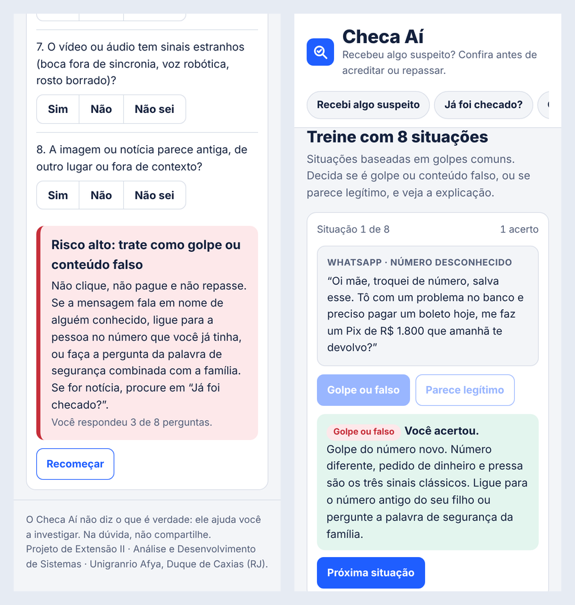

# Checa Aí

Site para verificar mensagens, notícias, imagens e vídeos suspeitos e se proteger de golpes que usam deepfakes e outros conteúdos gerados por inteligência artificial. Funciona no celular, sem cadastro e sem coletar dados de quem usa.

**Acesse:** https://dhony-bispo.github.io/checa-ai/

## Funcionalidades

- **Recebi algo suspeito:** 8 perguntas que calculam o nível de risco (baixo, atenção ou alto) e indicam o que fazer.
- **Já foi checado?:** busca pronta nas agências de checagem (Lupa, Aos Fatos, Fato ou Fake, Estadão Verifica, UOL Confere e Comprova), no Google Fact Check Explorer e no Google Notícias.
- **Checar imagem:** busca reversa no Google Lens, TinEye, Bing e Yandex a partir do link da imagem, com passo a passo para imagens recebidas no WhatsApp e sinais de vídeo ou áudio manipulado.
- **Treinar:** 8 situações baseadas em golpes comuns, com pontuação e explicação de cada resposta.
- **Caí num golpe:** o que fazer na hora (banco, MED do Pix, boletim de ocorrência, WhatsApp clonado).
- **Proteger contas:** checklist de segurança salvo no próprio aparelho.

## Tecnologias

HTML, CSS e JavaScript puros, em um único arquivo, sem frameworks nem dependências. Tema claro e escuro automático, layout pensado primeiro para o celular e navegação por âncoras (`#roteiro`, `#treino`...). Publicado com GitHub Pages.

## Como rodar localmente

Baixe o repositório e abra o arquivo `index.html` no navegador. Não precisa instalar nada.

## Contexto

Desenvolvido em grupo para a disciplina Projeto de Extensão II do curso de Análise e Desenvolvimento de Sistemas da Unigranrio Afya (Duque de Caxias, RJ), para ser usado em uma oficina presencial de treinamento sobre identificação de deepfakes e prevenção de golpes digitais.

Integrantes: Cauã Duarte Vieira, Daniel Silva Mendes de Luna e Dhony Moreira Bispo.
Professor: Carlos Ribeiro da Cunha.

## Aviso

O Checa Aí não diz o que é verdade: ele ajuda a investigar. Nenhum sinal visual prova sozinho que um conteúdo é falso. Na dúvida, não compartilhe.
